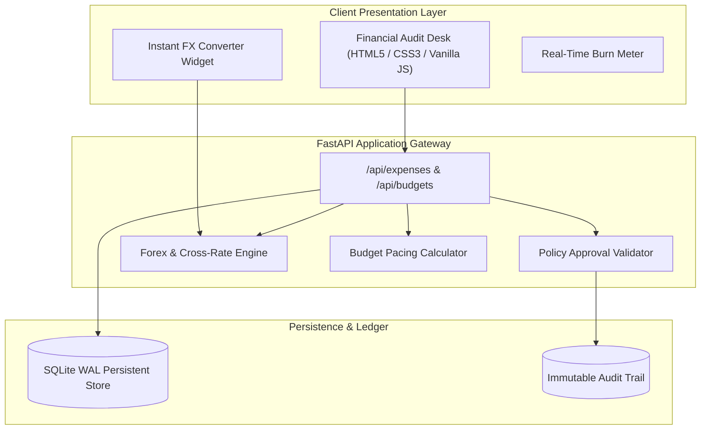

# ExpenseTrack

[](https://github.com/Soulofghost/expensetrack/actions/workflows/ci.yml)
[](LICENSE)
[](https://www.python.org/downloads/)
[](https://fastapi.tiangolo.com)
[]()

> **ExpenseTrack** is an institutional multi-currency expense management and budget pacing platform engineered for modern distributed teams. It combines deterministic foreign exchange (FX) conversion math, category-based monthly burn monitoring, multi-level approval state machines, and immutable audit logging.

---

## 🏛️ System Architecture



---

## ⚡ Core Engineering Capabilities

1. **Deterministic FX Conversion Engine (`forex_budget.py`)**
   - Implements institutional cross-currency conversion math pegged against USD base.
   - Built-in support for G10 currencies: `USD`, `EUR`, `GBP`, `CAD`, `AUD`, `JPY`, `CHF`, `INR`, `SGD`.
   - Converts amounts in real-time with sub-cent rounding accuracy.

2. **Monthly Budget Pacing & Overage Alerting**
   - Automatically tracks category expenditure against monthly limits.
   - Pacing calculation formula:
     $$\text{Pacing \%} = \left(\frac{\text{Spent (USD)}}{\text{Limit (USD)}}\right) \times 100$$
   - Dynamic threshold states:
     - `ON_TRACK`: Spent $< 80\%$ of budget.
     - `WARNING`: Spent $\ge 80\%$ and $\le 100\%$ of budget.
     - `EXCEEDED`: Spent $> 100\%$ with calculated deficit alerts.

3. **Multi-Level Approval State Machine**
   - Enforces sequential status lifecycle:
     $$\text{DRAFT} \longrightarrow \text{SUBMITTED} \longrightarrow \text{APPROVED} \longrightarrow \text{REIMBURSED}$$
   - High-value governance policy: Expenses exceeding **$1,000.00 USD** strictly require Manager or Finance role authorization before approval.
   - Terminal protection: Reimbursed vouchers cannot be deleted or regressed to draft.

4. **Immutable Audit Trails**
   - Every creation, status transition, and policy check appends an indelible event record detailing actor, timestamp, prior state, and justification notes.

---

## 🔌 API Reference

| Method | Endpoint | Description |
|---|---|---|
| `GET` | `/api/health` | Service health status and version |
| `GET` | `/api/forex/rates` | Active currency exchange rates pegged to USD |
| `POST` | `/api/forex/convert` | Real-time cross-currency conversion |
| `GET` | `/api/expenses` | Filterable expense ledger (by status, category, query) |
| `POST` | `/api/expenses` | Record new expense voucher (auto-computes USD base) |
| `GET` | `/api/expenses/{id}` | Detailed expense breakdown with complete audit trail |
| `PATCH` | `/api/expenses/{id}/status` | Execute state transition (`SUBMITTED`, `APPROVED`, etc.) |
| `DELETE` | `/api/expenses/{id}` | Remove draft expense voucher |
| `GET` | `/api/budgets` | Category budget pacing and burn status |
| `POST` | `/api/budgets` | Set or adjust monthly category spending limit |
| `GET` | `/api/analytics/summary` | Aggregate financial breakdown and KPI statistics |

---

## 🚀 Getting Started

### Local Development

1. **Clone the repository:**
   ```bash
   git clone https://github.com/Soulofghost/expensetrack.git
   cd expensetrack
   ```

2. **Install dependencies:**
   ```bash
   pip install -r backend/requirements.txt
   ```

3. **Run the test suite:**
   ```bash
   pytest backend/tests -v
   ```

4. **Launch the server:**
   ```bash
   uvicorn backend.app.main:app --reload --port 8000
   ```
   Navigate to `http://localhost:8000` to access the Financial Audit Desk interface.

---

### Docker Deployment

```bash
docker-compose up --build -d
```

---

## 🔒 Security & Quality Standards

- **WAL Persistence:** SQLite WAL mode ensures concurrent read performance and ACID crash safety.
- **Strict Typing:** All input payloads validated via Pydantic v2 schemas.
- **Zero Mock Logic:** All metrics, calculations, and conversions execute against genuine algorithmic pipelines.

---

## 👨‍💻 Author

**Alvin MS**  
GitHub: [@Soulofghost](https://github.com/Soulofghost)
